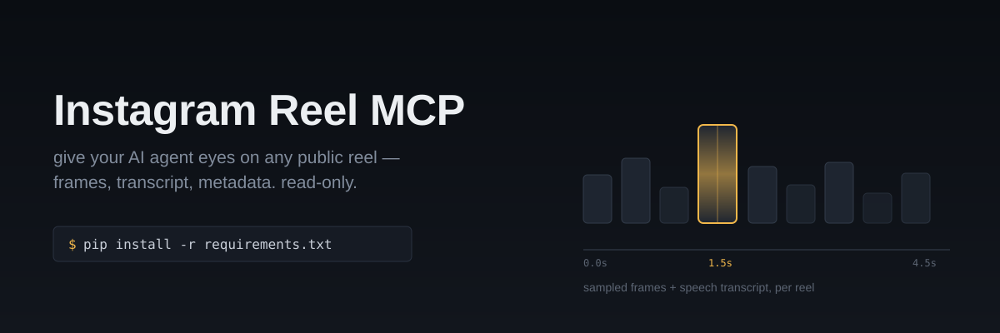

<p align="center">
  
</p>

<p align="center">
  <a href="LICENSE"></a>
  
  
</p>

# Instagram Reel MCP

An MCP server that gives an AI coding agent (Claude Code or any
MCP-compatible client) direct access to a **public** Instagram Reel by
URL — the video, sampled frames, a speech transcript, and metadata.
Read-only by design: there is no comment, like, share, follow, or post
capability anywhere in this code. Nothing to disable — it was never built.

## Why this exists

Most "Instagram downloader" tools are built for humans clicking a
download button. This one is built for an AI agent that needs to
*look at* a reel programmatically — e.g. to analyze a demo, pull a
transcript, or inspect frames — as one step inside a larger agentic
workflow, not as a standalone app.

## Tools

### `fetch_instagram_reel(url)`
Downloads the video, returns the file path and metadata. Fast.

```json
{
  "video_path": "/tmp/ig_reel_mcp/C9xYz123abc.mp4",
  "thumbnail_path": "/tmp/ig_reel_mcp/C9xYz123abc.jpg",
  "caption": "...",
  "uploader": "...",
  "duration_seconds": 38,
  "view_count": 2100000,
  "like_count": 143000,
  "comment_count": 4200,
  "upload_date": "20261015"
}
```

### `analyze_instagram_reel(url, frame_interval_seconds=1.5, max_frames=30)`
Everything above, plus sampled video frames (for the agent's own vision
to inspect) and a local Whisper transcript of the spoken audio.

```json
{
  "...": "all fields from fetch_instagram_reel, plus:",
  "frames": [
    {"timestamp_seconds": 0.0, "frame_path": "/tmp/.../frame_001.jpg"},
    {"timestamp_seconds": 1.5, "frame_path": "/tmp/.../frame_002.jpg"}
  ],
  "transcript": "okay so today I'm gonna show you how to..."
}
```

Analysis is request-time only — nothing here trains or fine-tunes a
model, and nothing persists across calls except the downloaded files.

## Setup

```bash
pip install -r requirements.txt
```

System binaries required (not installable via pip):
- **ffmpeg** — frame extraction. `apt install ffmpeg` / `brew install ffmpeg`.
- **yt-dlp** — installed via pip above; confirm it resolved to an executable on PATH.

First call to `analyze_instagram_reel` downloads the Whisper "base"
model (~150MB) from Hugging Face — one-time delay. Change
`_WHISPER_MODEL_SIZE` in `server.py` (`tiny` / `base` / `small` /
`medium`) to trade speed for accuracy.

If downloads fail with 401/403-style errors, Instagram is asking for a
logged-in session:

1. Install a browser extension like "Get cookies.txt LOCALLY".
2. Log into Instagram in your browser, export cookies for instagram.com.
3. Set `COOKIES_FILE` at the top of `server.py` to that file's path.

## Register with Claude Code

```json
{
  "mcpServers": {
    "instagram-reel": {
      "command": "python",
      "args": ["/absolute/path/to/instagram-reel-mcp/server.py"]
    }
  }
}
```

## `SKILL.md`: idea-saturation filter

Also included: a skill that activates when a fetched reel is a "build
this" tutorial. It forces an evaluation of whether the idea is a real,
differentiated problem statement before treating it as worth
building — not just whether it's technically replicable. See
`SKILL.md` for the full filter.

## Known limitations

- **Instagram ToS**: scraping reel content this way sits outside
  Instagram's Terms of Service. Personal/research use — don't build a
  public-facing product on this without legal review.
- **Fragility**: Instagram changes its anti-bot measures periodically.
  If this breaks, update yt-dlp first (`pip install -U yt-dlp`).
- **Private/age-gated/removed posts** fail regardless of cookies.
- **Transcript covers speech, not on-screen text** — code snippets or
  UI text shown on screen aren't OCR'd; the agent's own vision reading
  the frame images covers that instead.
- **Rate limits**: heavy use is the fastest way to get a session or IP flagged.

## License

MIT — see [LICENSE](LICENSE).
